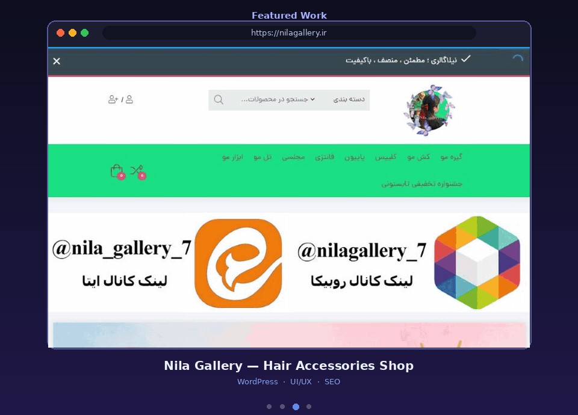

<h1 align="center">Nila Gallery — Hair Accessories Shop</h1>

<b>نیلا گالری</b> · <a href="https://nilagallery.ir">nilagallery.ir</a>

  

  
  
  
  

---

### 📌 About the Project

An online shop for hair accessories with a colorful, playful brand identity.

### ✨ Features

- Category mega-menu (clips, hair ties, bows, sets...)
- Product search with category selector
- Seasonal campaign banners
- Social channel integration
- Compare, wishlist and cart
- Fully responsive layout

### 🛠 My Role

- UI/UX design and layout
- WordPress & WooCommerce development
- Performance and SEO optimization

### 🔗 Live Website

👉 **[nilagallery.ir](https://nilagallery.ir)**

---

> 🔒 This is a **showcase** repository. The source code is private for client confidentiality.
> Interested in a similar project? Contact me on Telegram: **[@fesqhli](https://t.me/fesqhli)**

Made by <a href="https://github.com/zeroux-dev">ZERO (zeroux-dev)</a>

